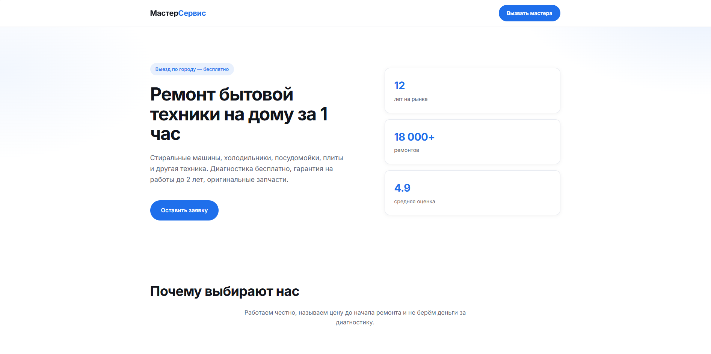
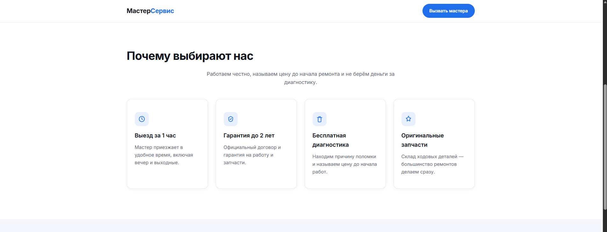
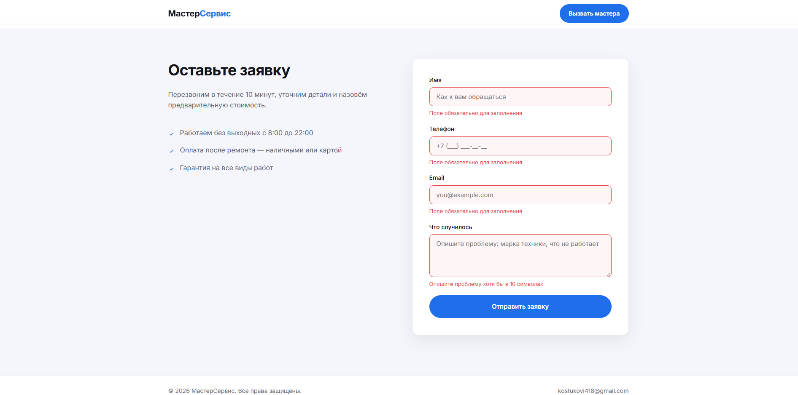
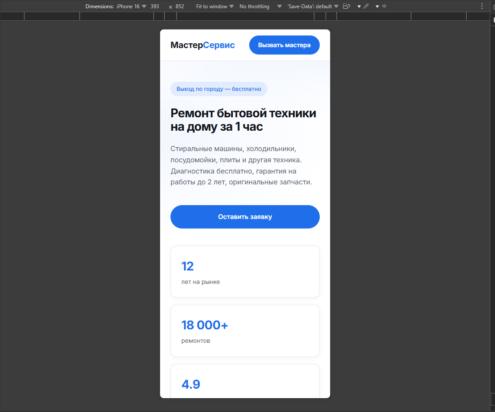

# Лендинг услуги «Ремонт бытовой техники на дому»

Одностраничный лендинг под типовой фриланс-заказ: первый экран с CTA,
блок преимуществ из четырёх карточек и форма заявки с валидацией.

## Стек

- HTML5 (семантическая вёрстка)
- CSS3 (Flexbox, Grid, CSS-переменные, медиазапросы)
- JavaScript (ES6+, IntersectionObserver, валидация формы)

## Деплой

[Открыть сайт](https://vir010.github.io/landing-master-service/)

## Как запустить локально

1. Склонировать репозиторий:

   ```
   git clone https://github.com/Vir010/landing-master-service.git
   ```

2. Открыть `index.html` в браузере или запустить Live Server в VS Code.

## Функциональность

- Три секции: первый экран с CTA, преимущества (четыре карточки), форма заявки.
- Анимация появления блоков при скролле через IntersectionObserver.
- Валидация формы: обязательные поля, проверка формата email,
  вывод ошибок под полями.
- Адаптив: десктоп, планшет (до 1024px), мобильный (до 768px).

## Что здесь особенного
В проекте реализована плавная анимация появления блоков при скролле с помощью библиотеки **AOS**. Форма заявки имеет кастомную валидацию на чистом JavaScript (проверка обязательных полей и формата email с выводом ошибок под полями). Вся верстка выполнена с использованием CSS Grid и Flexbox, адаптирована под мобильные устройства, планшеты и десктопы. Также добавлена поддержка `prefers-reduced-motion` для пользователей, предпочитающих отключенные анимации.

## Скриншоты




